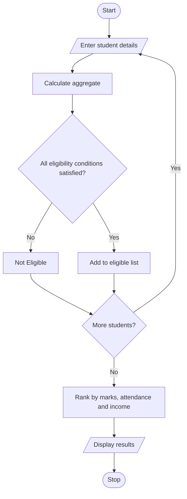

# University Scholarship Allocation System Using Python

## 1. Problem Statement

Develop a Python program to allocate university scholarships based on students' academic performance and financial background. The system evaluates students using aggregate marks, subject-wise minimum marks, attendance percentage, and annual family income.

The program identifies eligible students, ranks them based on their aggregate marks, and resolves ties using predefined rules such as higher attendance and lower family income.

## 2. Algorithm

1. Start the program.
2. Enter the number of students.
3. Set scholarship eligibility criteria:
   - Aggregate marks ≥ 75%.
   - Each subject mark ≥ 60%.
   - Attendance ≥ 75%.
   - Annual family income ≤ ₹2,50,000.
4. Enter each student's name, marks, attendance, and family income.
5. Calculate aggregate percentage.
6. Check all eligibility conditions.
7. Add eligible students to the scholarship list.
8. Rank eligible students using:
   - Higher aggregate percentage.
   - Higher attendance.
   - Lower family income.
9. Display the ranked scholarship list.
10. Stop the program.

## 3. Flowchart

## 5. Sample Input

Enter number of students: 3

Student 1
Enter name: Ravi
Enter 5 subject marks: 85 80 90 78 87
Enter attendance: 90
Enter annual family income: 200000

Student 2
Enter name: Kumar
Enter 5 subject marks: 80 85 75 90 80
Enter attendance: 85
Enter annual family income: 180000

Student 3
Enter name: Raju
Enter 5 subject marks: 55 80 75 90 85
Enter attendance: 95
Enter annual family income: 150000

## 6. Sample Output

--- Scholarship Eligible Students ---

Rank: 1
Name: Ravi
Aggregate: 84.0 %
Attendance: 90.0 %
Family Income: Rs. 200000.0

Rank: 2
Name: Kumar
Aggregate: 82.0 %
Attendance: 85.0 %
Family Income: Rs. 180000.0

Raju is not eligible because one subject mark is below 60.

Result: The Python program successfully evaluates scholarship applications, identifies eligible students, ranks them, and displays the final scholarship allocation list.
