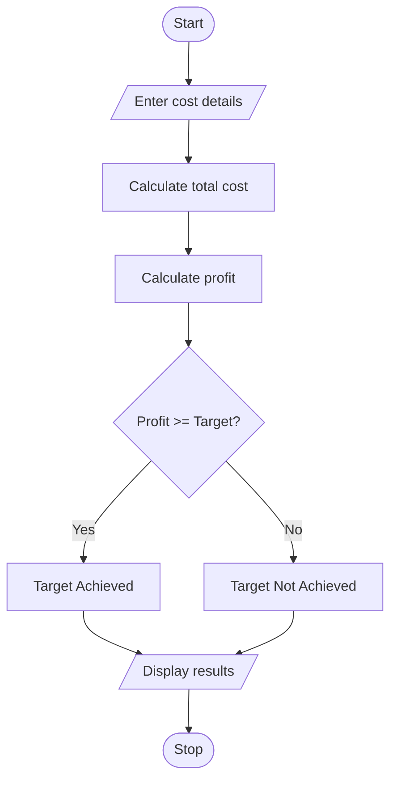

# Manufacturing Cost and Profitability Analysis Using Python

## 1. Problem Statement

Develop a Python program to calculate manufacturing costs using material costs, labour charges, wastage, and machine costs. Calculate selling price and determine whether production meets the specified profit target.

## 2. Algorithm

1. Start the program.
2. Enter material, labour, and machine costs.
3. Enter wastage percentage and selling price.
4. Calculate total production cost.
5. Calculate total profit.
6. Compare profit with target.
7. Display the result.
8. Stop.

## 3. Flowchart

## 5. Sample Input
Enter material cost: 10000
Enter labour charges: 3000
Enter machine cost: 2000
Enter wastage percentage: 10
Enter selling price: 18000
Enter profit target: 2000

## 6. Sample Output
--- Manufacturing Report ---
Total Cost: 16000.0
Selling Price: 18000.0
Profit: 2000.0
Profit Target Achieved

